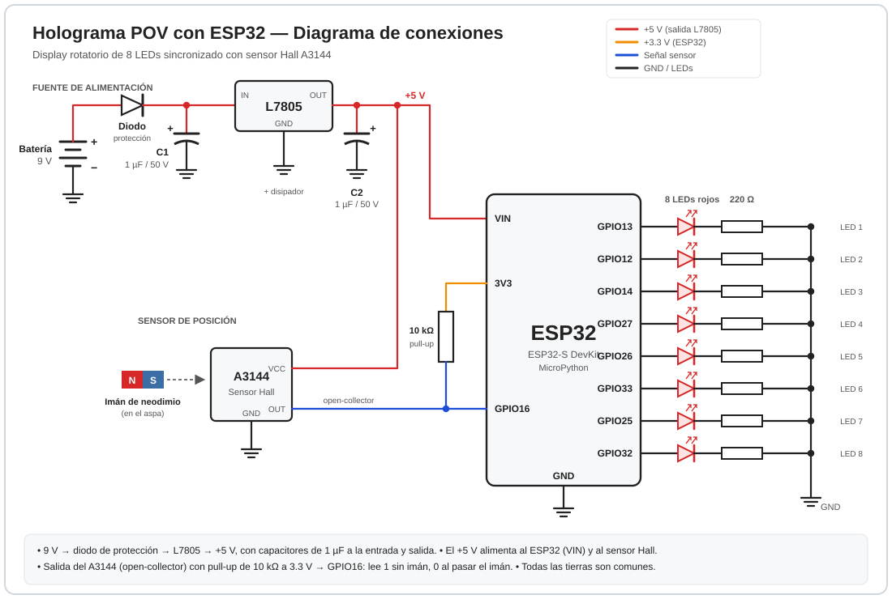

<div align="center">

# 🌀 Holograma POV con ESP32

**Display rotatorio de LEDs que escribe "HOLA" en el aire usando persistencia retiniana**


Práctica 7 de **Microcontroladores y Microprocesadores** — Universidad de Guanajuato (Ene–Jun 2026)

</div>

---

## 🎥 Proyecto funcionando

[](https://youtube.com/shorts/YVtooKpm8sI)

---

## 📋 Descripción

El ojo humano retiene una imagen durante aproximadamente 1/16 de segundo. Si una fila de LEDs gira a alta velocidad y se enciende en el ángulo exacto, todas esas "rebanadas" de luz se perciben como una sola imagen estática flotando en el aire (efecto **POV – Persistence of Vision**).

- Un **ESP32** programado en **MicroPython** controla una fila de **8 LEDs** montados sobre un aspa.
- El aspa gira impulsada por un taladro eléctrico.
- Un **sensor Hall A3144** fijo detecta un **imán de neodimio** pegado al aspa una vez por vuelta; esa señal reinicia el dibujo para que la palabra siempre aparezca en la misma posición.

## 🔌 Diagrama de conexiones

<p align="center">
  
</p>

### Lista de materiales

| Componente | Cantidad | Uso |
|---|---|---|
| ESP32‑S (DevKit) | 1 | Microcontrolador |
| Sensor de efecto Hall A3144 | 1 | Detecta una vuelta completa |
| Imán de neodimio (10 × 5 mm) | 1 | Pegado al aspa |
| LED rojo de alto brillo | 8 | Fila de "píxeles" |
| Resistencia 220 Ω | 8 | Limitadora de corriente de cada LED |
| Resistencia 10 kΩ | 1 | Pull‑up de la salida del sensor a 3.3 V |
| Regulador L7805 + disipador | 1 | 9 V → 5 V |
| Capacitor electrolítico 1 µF / 50 V | 2 | Filtrado en entrada y salida del regulador |
| Diodo | 1 | Protección contra inversión de polaridad |
| Batería alcalina 9 V | 1 | Alimentación |

### Asignación de pines

| LED | 1 | 2 | 3 | 4 | 5 | 6 | 7 | 8 |
|---|---|---|---|---|---|---|---|---|
| **GPIO** | 13 | 12 | 14 | 27 | 26 | 33 | 25 | 32 |

| Señal | Pin ESP32 |
|---|---|
| Salida del sensor Hall (con pull‑up 10 kΩ a 3.3 V) | GPIO16 |
| +5 V del L7805 | VIN |
| Tierra común | GND |

> **¿Por qué el pull‑up a 3.3 V?** El A3144 se alimenta con 5 V pero tiene salida *open‑collector*: sólo "jala" la línea a tierra. Con la resistencia a 3.3 V la señal queda en **3.3 V sin imán** y **0 V con imán**, niveles seguros para el ESP32.

## 🧠 Cómo funciona el código

El programa está en [`src/main.py`](src/main.py).

1. **Patrón:** cada letra es una matriz de 8 filas (una por LED) × 7 columnas. `unir_letras()` las concatena en un solo patrón:

   ```
   ██          ██        ██████████        ██                    ██████████
   ██          ██      ██          ██      ██                  ██          ██
   ██          ██      ██          ██      ██                  ██          ██
   ██████████████      ██          ██      ██                  ██████████████
   ██          ██      ██          ██      ██                  ██          ██
   ██          ██      ██          ██      ██                  ██          ██
   ██          ██      ██          ██      ██                  ██          ██
   ██          ██        ██████████        ██████████████      ██          ██
   ```

2. **Sincronización:** el bucle principal detecta el **flanco de bajada** del sensor (1 → 0), es decir, el instante en que el imán pasa.
3. **Dibujo:** en cada vuelta recorre las columnas; enciende los LEDs de esa columna durante `PULSO_US`, los apaga y espera el resto de `TIEMPO_COLUMNA_US`.

### Parámetros de calibración

| Constante | Valor | Qué controla |
|---|---|---|
| `TIEMPO_VUELTA_US` | `20000` | Tiempo de una vuelta (µs). Se ajusta experimentalmente según la velocidad del taladro. |
| `COLUMNAS_TOTALES` | `40` | En cuántas "rebanadas" se divide una vuelta. Más columnas = más resolución. |
| `TIEMPO_COLUMNA_US` | `TIEMPO_VUELTA_US // COLUMNAS_TOTALES` | Tiempo disponible por columna. |
| `PULSO_US` | `50` | Tiempo encendido por columna. Más corto = más nítido; más largo = más brillo. |

## 🚀 Cómo cargarlo al ESP32

1. Instala el firmware de [MicroPython para ESP32](https://micropython.org/download/ESP32_GENERIC/).
2. Abre [Thonny](https://thonny.org/) (o usa `mpremote`), selecciona el intérprete *MicroPython (ESP32)*.
3. Sube [`src/main.py`](src/main.py) al ESP32 con el nombre `main.py` para que se ejecute al encender:

   ```bash
   mpremote connect COM3 cp src/main.py :main.py
   ```

4. Pon a girar el aspa y ajusta `TIEMPO_VUELTA_US` hasta que la palabra se vea estable.

## 📁 Estructura del repositorio

```
Holograma-POV-ESP32/
├── src/
│   └── main.py                                # Código MicroPython
├── img/
│   └── diagrama_conexiones.svg                # Diagrama de conexiones
├── docs/
│   └── Reporte_Practica7_Sistema_de_LEDs.pdf  # Reporte de la práctica
└── README.md
```

## 📄 Documentación

El reporte completo (diseño mecánico, electrónico, explicación del código y resultados) está en [`docs/Reporte_Practica7_Sistema_de_LEDs.pdf`](docs/Reporte_Practica7_Sistema_de_LEDs.pdf).

---

<div align="center">

Hecho por **Erick Isaac Guzmán Paniagua**

</div>
